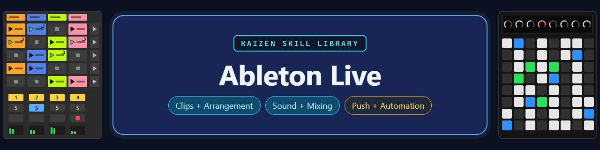

# Ableton Live Agent Skill



Gives Claude Code, Codex and other coding agents the Ableton Live 12 manual as 492 topic pages, so they can answer with the control names, device parameters and steps Live uses for clips, warping, MIDI, mixing, devices, Max for Live and Push.

**Status: early draft.** The reference pages are in place; scripts, assets and evaluations will be added over time.

## Install

```sh
npx skills add LevyBytes/AI-SKILL-ableton-live -g
```

This installs the skill as `ableton-live` for each coding agent it finds on your computer; without `-g` it goes into the current project only. The command needs Node.js 22.20 or later.

<details>
<summary>Install without Node.js</summary>

Clone the repository into your agent's skills folder:

| Agent | Command |
| --- | --- |
| Claude Code | `git clone https://github.com/LevyBytes/AI-SKILL-ableton-live ~/.claude/skills/ableton-live` |
| Codex | `git clone https://github.com/LevyBytes/AI-SKILL-ableton-live ~/.agents/skills/ableton-live` |

</details>

## Use

Ask your agent about Ableton Live as usual; it loads the skill when a task matches. You can also call it by name with `/ableton-live` in Claude Code or `$ableton-live` in Codex.

- "How do Chance A and Chance B decide which Follow Action fires in Live 12?"
- "Which warp mode suits a drum loop, and what does its Preserve setting do?"
- "How do I duck background music under a voiceover with Compressor's sidechain?"
- "Which stems does Live 12's stem separation create, and does it need an internet connection?"

## What's inside

| Area | Pages | Covers |
| --- | ---: | --- |
| [Getting started and navigation](references/topics-getting-started-and-navigation.json) | 33 | Setup, views, shortcuts and accessibility |
| [Browser and project files](references/topics-browser-and-project-files.json) | 34 | Sounds, Packs, libraries, Live Sets and project files |
| [Arrangement and clip performance](references/arrangement-and-clip-performance-index.md) | 21 | Arrangement timeline, Session clips, launch settings and Follow Actions |
| [Audio clips and editing](references/topics-audio-clips-and-editing.json) | 33 | Audio clip editing, warping, stem separation and video |
| [MIDI notes and expression](references/topics-midi-notes-and-expression.json) | 56 | Note editing, MIDI Tools, MIDI effects, MPE, groove and tuning |
| [Recording, routing, and mixing](references/recording-routing-and-mixing-index.md) | 32 | Recording, audio and MIDI routing, comping and mixing |
| [Devices, racks, and plug-ins](references/devices-racks-and-plug-ins-index.md) | 27 | Devices, plug-ins, Racks and Macro Controls |
| [Automation and modulation](references/automation-and-modulation-index.md) | 15 | Automation recording and editing, clip envelopes and modulation |
| [Audio effects](references/topics-audio-effects.json) | 74 | Built-in audio effects and their controls |
| [Instruments and sound design](references/topics-instruments-and-sound-design.json) | 71 | Built-in instruments, synthesizers and samplers |
| [Max for Live](references/topics-max-for-live.json) | 14 | Max for Live setup, devices and MIDI Tools |
| [Controllers and synchronization](references/topics-controllers-and-synchronization.json) | 20 | Controller mapping, Link and MIDI sync |
| [Push 1](references/push-1-index.md) | 20 | Playing, sequencing, recording and control with Push 1 |
| [Push 2](references/push-2-index.md) | 29 | Playing, sequencing, sample editing and control with Push 2 |
| [Performance and signal integrity](references/topics-performance-and-signal-integrity.json) | 13 | CPU load, dropouts, signal changes, MIDI latency and jitter |

Every page follows the Live 12 manual. The [reference index](references/INDEX.md) lists each area with the tasks it answers.

## When agents load this skill

Use for Ableton Live 12 (the DAW): Arrangement and Session views, clips and Clip View, warping and tempo, MIDI and MPE editing, MIDI tools, audio-to-MIDI, comping, stem separation, recording, routing and I/O, mixing, automation and clip envelopes, instrument/drum/effect racks, browser and file management, built-in instruments and effects, Max for Live, Push 1 and 2, Link, tuning systems, shortcuts and accessibility. Not for other DAWs.

## The work behind the references

The Live manual material is interpreted into topic references and task-oriented catalogs. Editing retained device parameters, units and control names while repairing identified keyboard-label and list-boundary defects, making those details usable without loading the entire manual.

## Contributing

Pull requests are accepted from approved contributors only. To propose a fix or a feature, first open an issue that describes the change your pull request would make, such as a page that is wrong or out of date and the Live manual section it should match. The maintainer reviews the issue and your GitHub account, then approves or declines. New maintainers are approved the same way. See [CONTRIBUTING](.github/CONTRIBUTING.md).

## Sources and license

Skill reference documentation is interpreted content for use in open source projects. Check against [official documentation sources](https://www.ableton.com/en/live-manual/12/) when dealing with defects or issues that may come up from interpreting this skill's references.

Licensed under **Apache-2.0**; see [LICENSE](LICENSE). Part of the [Agent Kaizen](https://github.com/LevyBytes/agent-kaizen) skill library.
