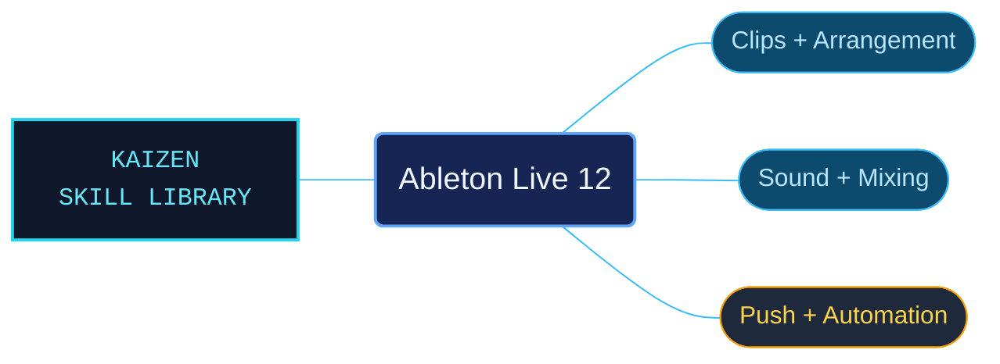

# Ableton Live 12

An organized reference companion for music production in Ableton Live 12. Task-focused catalogs connect recording, clip editing, instruments, effects and mixing with the controls and terminology documented in the Live manual.

Use when working with Ableton Live 12 (the DAW): the Arrangement and Session views; clips and the Clip View; audio warping and tempo; MIDI and MPE editing; MIDI tools; converting audio to MIDI; comping; stem separation; recording; routing and I/O; mixing; automation and clip envelopes; instrument/drum/effect racks; the browser and managing files/sets; Live's built-in instruments, audio effects, and MIDI effects; Max for Live; Push 1 and Push 2; Link/tempo sync; tuning systems; keyboard shortcuts; and accessibility. The official Live 12 Reference Manual. Not for other DAWs.

## What this skill helps with

| Task | Useful reference material |
| --- | --- |
| [Build and edit a performance](references/arrangement-and-clip-performance-index.md) | Find Arrangement, Session and clip-performance workflows. |
| [Record, route and mix](references/recording-routing-and-mixing-index.md) | Follow recording and signal-routing material through to mixing decisions. |
| [Shape sounds and devices](references/devices-racks-and-plug-ins-index.md) | Work with devices, racks and plug-ins, with separate instrument and effect catalogs. |
| [Control and automate a set](references/automation-and-modulation-index.md) | Locate automation and modulation guidance alongside the Push and synchronization references. |

## The work behind the references

The Live manual material is interpreted into topic references and task-oriented catalogs. Editing retained device parameters, units and control names while repairing identified keyboard-label and list-boundary defects, making those details usable without loading the entire manual.

## Start here

Start with [SKILL.md](SKILL.md) and follow its context routes.

The package targets the Live 12 manual and includes separate [Push 1](references/push-1-index.md) and [Push 2](references/push-2-index.md) catalogs. Follow the documented device, platform and edition conditions for the selected workflow.

## Sources and license

Skill reference documentation is interpreted content for use in open source projects. Check against [official documentation sources](https://www.ableton.com/en/live-manual/12/) when dealing with defects or issues that may come up from interpreting this skill's references.

Licensed under **AGPL-3.0**; see [LICENSE](LICENSE). Part of the [Agent Kaizen](https://github.com/LevyBytes/agent-kaizen) skill library.
